# Tutorial — Publicar el sistema en internet (PHP + MariaDB)

**Hasta aquí el proyecto corrió en su máquina**, con un solo `docker compose up`:
seis contenedores que nacen juntos. **Aquí sale a internet** — y con una
condición que no es menor: **sin cambiar de motor**. Lo que se publica es la
misma MariaDB que usted entrega.

| La pieza | Dónde va a quedar |
|---|---|
| **La base de datos** — MariaDB | **alwaysdata** |
| **La API** — PHP | **alwaysdata**, un sitio |
| **El front** — PHP | **alwaysdata**, otro sitio |

> **Todo en un solo proveedor, y sin Docker.** No porque Docker estorbe, sino
> porque aquí no hace falta: alwaysdata **ya tiene PHP instalado**. Se suben
> los archivos y corren. El `docker-compose.yml` del repositorio sigue siendo
> para su máquina.

---

## Por qué alwaysdata, y no los otros

**Esta parte vale más que el despliegue**, porque es el trabajo que un
ingeniero hace antes de escoger dónde pone un sistema. Las opciones se
revisaron el **13 de noviembre de 2026**, una por una.

**El problema no era PHP: era la base de datos.** Este proyecto pone lógica
*dentro* de MariaDB —seis disparadores que calculan subtotales, totales y
stock, y dieciséis procedimientos—, y eso es justo lo que casi ningún
hospedaje gratuito permite.

| Hospedaje | Qué pasó |
|---|---|
| **InfinityFree** | Corre PHP y MySQL, pero su plan gratuito **desactiva llaves foráneas, procedimientos y disparadores**. Y hay algo peor para nosotros: su sistema anti-robots **responde una página de JavaScript a cualquier programa** que llame al sitio — o sea que **una API alojada ahí deja de ser una API** |
| **TiDB Cloud** | Gratis y compatible con MySQL, pero **no tiene disparadores ni procedimientos** |
| **Aiven** | Tenía MySQL gratuito. Lo está retirando: desde el **6 de noviembre de 2026** no deja crear nuevos y el **21 de diciembre** apaga los que quedan |
| **PlanetScale** | Cerró su plan gratuito en 2024 |
| **Render** | Corre cualquier `Dockerfile`, pero **no ofrece MySQL**: habría que irse a PostgreSQL, y entonces ya no sería lo que los estudiantes entregan |
| **alwaysdata** | **1 GB gratis, de por vida, sin tarjeta. MariaDB administrada con `GRANT ALL` sobre sus bases de datos — y hospedaje PHP en la misma cuenta** |

> **La lección, que es del oficio y no del tutorial:** PostgreSQL tiene varios
> hospedajes gratuitos que duran porque hay empresas compitiendo ahí. **En
> MySQL esa competencia se apagó** — PlanetScale cobró, Aiven cerró—, y lo que
> queda gratis casi siempre viene recortado: sin rutinas, sin llaves foráneas,
> o sin dejar que nadie llame a su servidor.
>
> **Quien ponga la lógica dentro de la base de datos tiene que averiguar esto
> ANTES de elegir dónde publicar.** No después.

---

## Lo que cuesta: nada

| | El plan `Free` de alwaysdata |
|---|---|
| **Disco** | 1 GB, de por vida |
| **Memoria** | 256 MB · ¼ de CPU |
| **Bases de datos y sitios** | sin límite de cantidad |
| **Tarjeta de crédito** | **ninguna** |
| **La letra menuda** | es para **uso personal**, no comercial, y el espacio de las bases de datos es una décima parte del total |

---

## Los pasos

| | Qué se hace | Dónde |
|---|---|---|
| **1** | La cuenta | alwaysdata |
| **2** | La base de datos MariaDB | el panel |
| **3** | Preparar el `.sql` — **lo único que hay que cambiarle** | su editor |
| **4** | Importar el esquema y comprobar las rutinas | phpMyAdmin |
| **5** | Subir la API y el front | FTP |
| **6** | La configuración de la conexión | el servidor |
| **7** | La prueba del sistema completo | el navegador |

---

## Paso 1 — La cuenta

```
https://www.alwaysdata.com/en/offers/
```

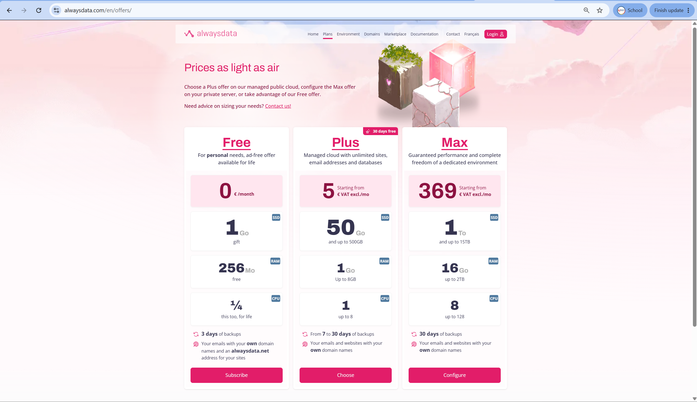

**La tarjeta de la izquierda: `Free`, 0 €/mes.** No la del medio: ese
*«30 days free»* es la prueba de un plan de pago, y después cobra.

`Subscribe` lleva al registro:

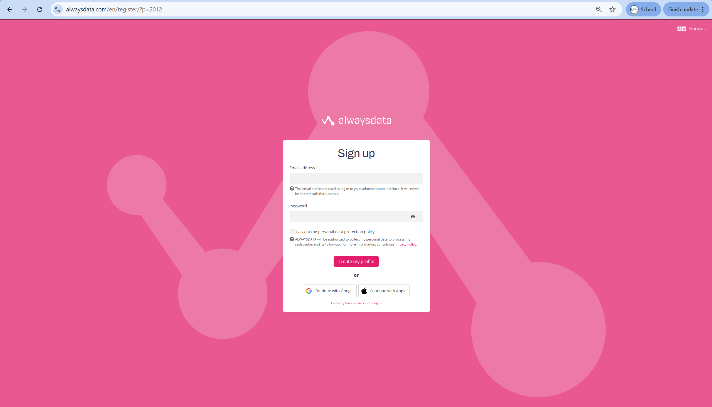

> **Mire la dirección: termina en `?p=2012`.** Ese número es el plan gratuito,
> y es lo que lo mantiene enganchado mientras usted se registra. Si usted ya
> tiene cuenta, entre por **`I already have an account. Log in`** desde esta
> misma pantalla.

### 1.1 · La selección de oferta

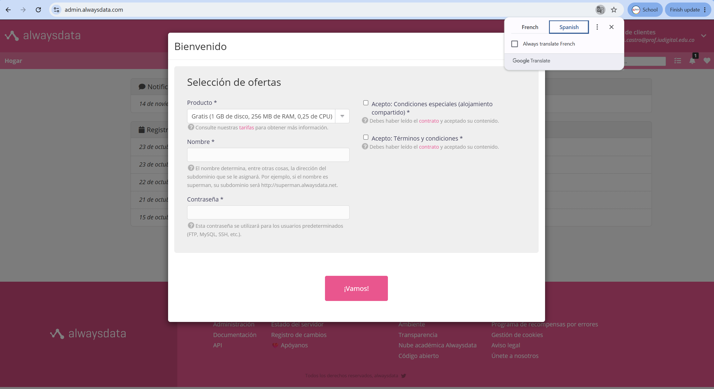

| La casilla | **Lo que se escribe** | Para qué |
|---|---|---|
| **`Producto`** | **`Gratis (1 GB de disco, 256 MB de RAM, 0,25 de CPU)`** | **Viene marcado «Pequeño (50 GB)», que es de pago.** Hay que cambiarlo a mano |
| `Nombre` | **`phpfacturas`** | Define el subdominio: `phpfacturas.alwaysdata.net`. Y también el prefijo de sus bases de datos |
| `Contraseña` | una suya | **Es la misma para FTP, MySQL y SSH.** Anótela |
| Las dos casillas de la derecha | marcadas | |

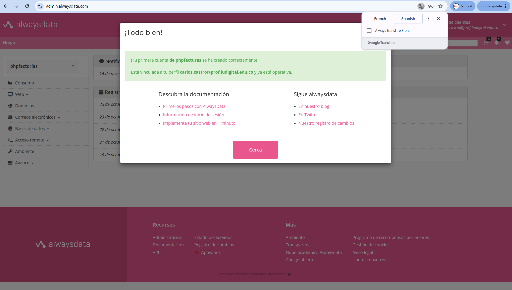

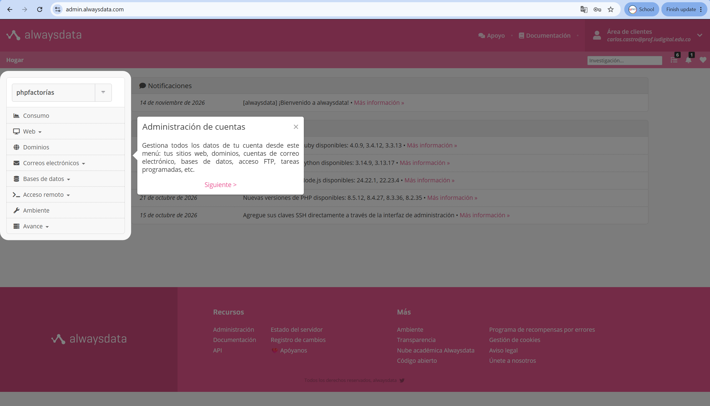

---

## Paso 2 — La base de datos

**Menú de la izquierda: `Bases de datos` → `MySQL`.**

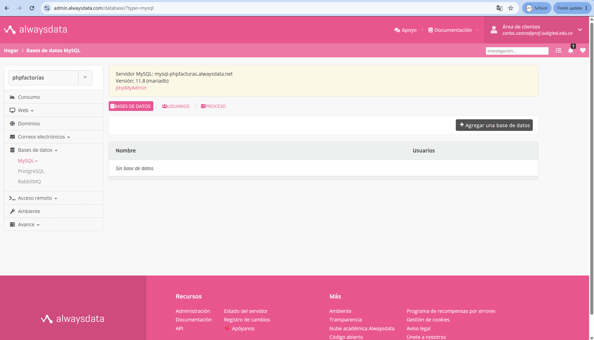

**Lea el recuadro amarillo, que trae los tres datos que va a necesitar después:**

```
Servidor MySQL: mysql-phpfacturas.alwaysdata.net
Versión: 11.8 (mariadb)
phpMyAdmin
```

| Lo que dice | Por qué importa |
|---|---|
| **`mariadb`, no `mysql`** | es **el mismo motor** del `docker-compose.yml` (`mariadb:11`). No hay que traducir nada |
| **`11.8`** | la misma serie mayor que en su máquina |
| El servidor es **un nombre público** | `mysql-phpfacturas.alwaysdata.net` se resuelve desde internet — eso servirá si algún día la API se va a otro hospedaje |

**`+ Agregar una base de datos`:**

| La casilla | **Lo que se escribe** | Para qué |
|---|---|---|
| `Nombre` | **`phpfacturas_bdfacturas`** | el panel **obliga** al prefijo de la cuenta: no puede llamarse `bdfacturas` a secas |
| `Permisos` | **`todos los derechos`** | sin esto no se pueden crear disparadores ni procedimientos |

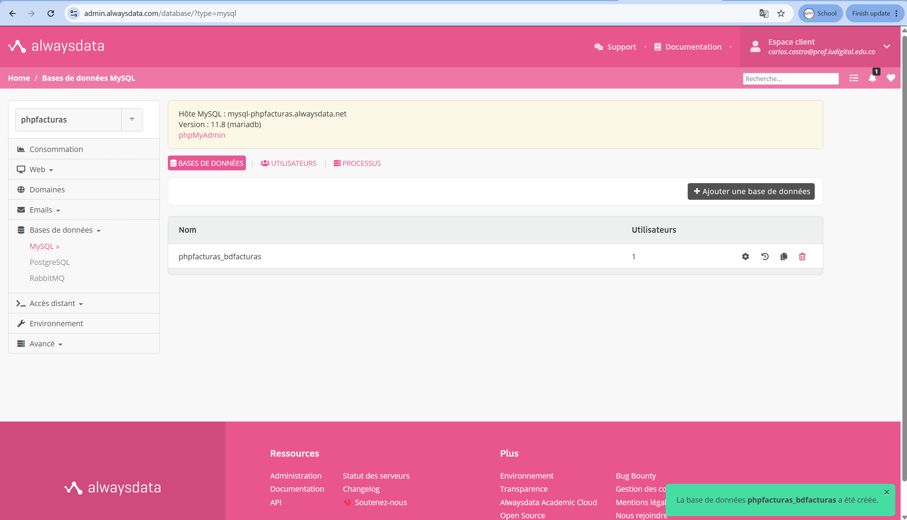

---

## Paso 3 — Preparar el `.sql`

**Y aquí está lo único que hay que cambiarle al script del repositorio.** Son
dos renglones:

```sql
CREATE DATABASE IF NOT EXISTS bdfacturas_mariadb_local ...;
USE bdfacturas_mariadb_local;
```

| Por qué estorban | |
|---|---|
| **`CREATE DATABASE`** | la base de datos **ya existe** —la creó usted en el paso 2— y además **un usuario de hospedaje compartido no tiene permiso para crear bases de datos** |
| **`USE`** | el nombre real lleva el prefijo de la cuenta: `phpfacturas_bdfacturas`, no el del portátil |

**El repositorio ya trae la variante lista**, para no editar nada a mano:

```
db/mariadb/init_hospedaje.sql
```

Es **idéntico** a `db/mariadb/init.sql` salvo esos dos renglones. Mismas tablas,
mismas llaves foráneas, mismos seis disparadores, mismos dieciséis
procedimientos y los mismos datos.

### La lista de chequeo, para cuando el script sea el suyo

**Un estudiante que publique su propio proyecto tiene que mirar cuatro cosas
en su `.sql`:**

| Qué buscar | Por qué quitarlo |
|---|---|
| `CREATE DATABASE ...` | el hospedaje ya la creó, y su usuario no puede crear otras |
| `USE ...` | el nombre real lleva prefijo |
| **`DEFINER=`root`@`localhost`**` | si exportó con phpMyAdmin o Workbench, **los procedimientos salen marcados a nombre de `root`** — y su usuario no puede crear objetos a nombre de otro. El script muere ahí |
| `CREATE USER` / `GRANT` | los usuarios se crean desde el panel, no desde el script |

**Todo lo demás se sube tal cual.**

---

## Paso 4 — Importar, y la prueba que decide todo

**En el panel, el enlace `phpMyAdmin` del recuadro amarillo.** Entra con el
usuario **`phpfacturas`** y la contraseña de la cuenta.

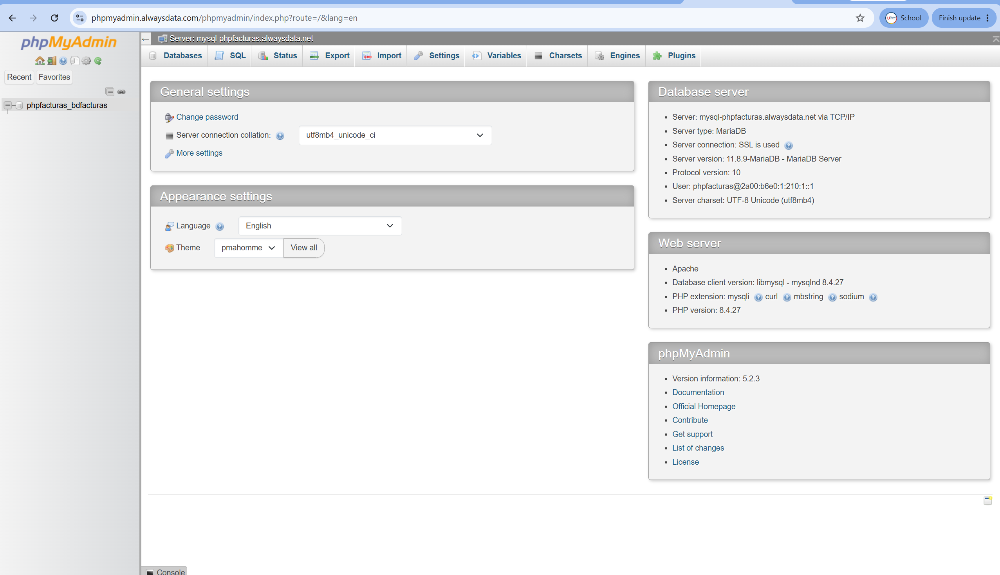

### 4.1 · El error que todo el mundo comete primero

**Si usted va directo a la pestaña `Import`, el título dice
«Importing into the current server»** — al *servidor*, no a una base de datos.
Y como le quitamos el `USE`, el script no sabe dónde crear nada:

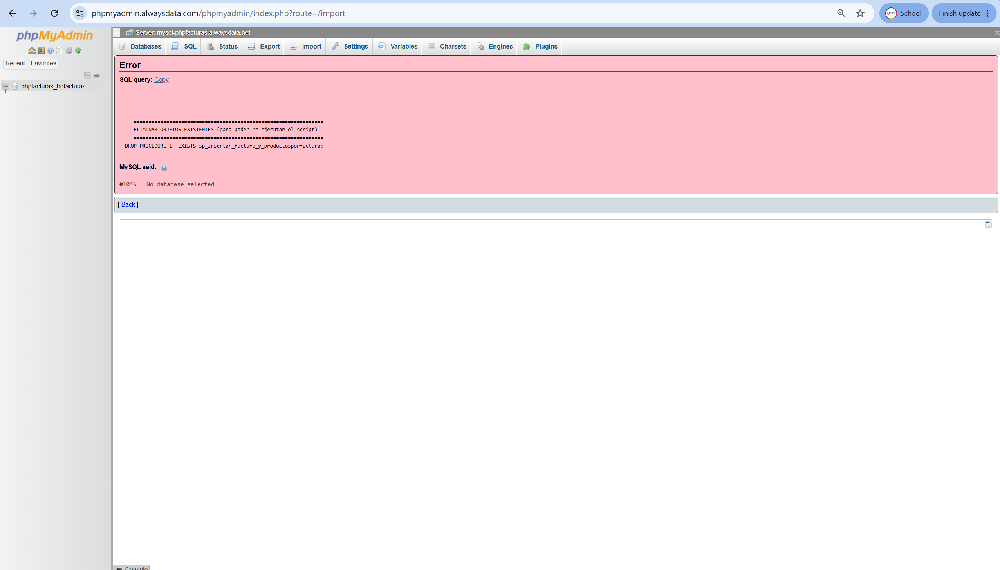

```
#1046 - No database selected
```

> **No es un error del script ni del hospedaje: es de dónde estaba parado.**
> Primero se hace clic en **`phpfacturas_bdfacturas`**, en la columna
> izquierda, y se comprueba que la barra gris de arriba diga
> **`Database: phpfacturas_bdfacturas`**. Ahí sí, `Import`.

### 4.2 · La importación

`Choose File` → `init_hospedaje.sql` → **`Import`**.

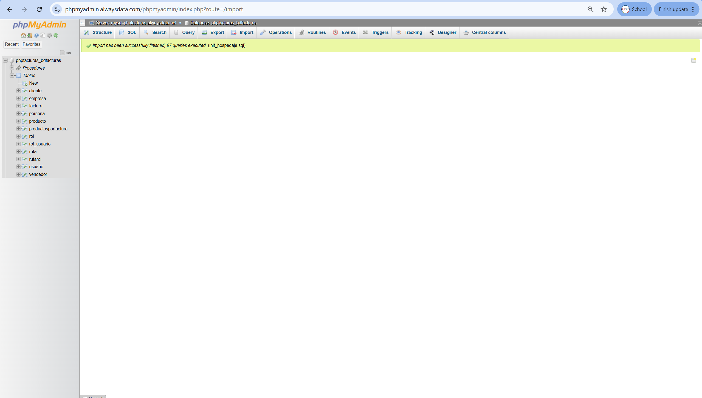

```
Import has been successfully finished, 97 queries executed. (init_hospedaje.sql)
```

### 4.3 · Comprobar que las rutinas de verdad entraron

**Este es el momento que justifica haber escogido alwaysdata**, así que no se
salte la comprobación.

**Pestaña `Routines`** — dieciséis procedimientos:

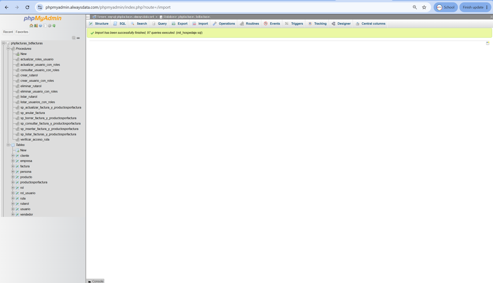

**Pestaña `Triggers`** — seis disparadores sobre `productosporfactura`:

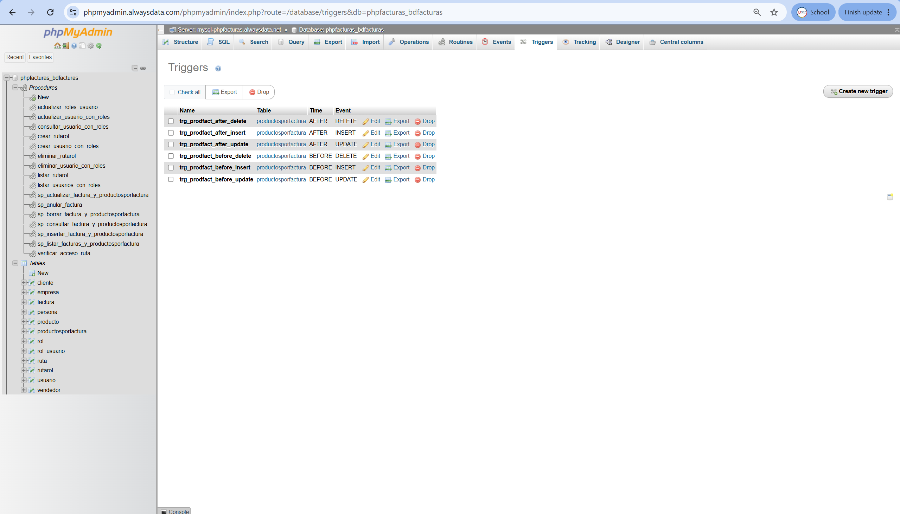

```
trg_prodfact_before_insert   BEFORE  INSERT
trg_prodfact_after_insert    AFTER   INSERT
trg_prodfact_before_update   BEFORE  UPDATE
trg_prodfact_after_update    AFTER   UPDATE
trg_prodfact_before_delete   BEFORE  DELETE
trg_prodfact_after_delete    AFTER   DELETE
```

> **Esos seis son los que InfinityFree no habría dejado crear**, y sin ellos
> la facturación no funciona: el subtotal, el total y el descuento de stock
> **los calcula la base de datos**, no el PHP.

> **Y un detalle del script que vale leer:** los disparadores se crean,
> después se **borran** para sembrar los datos de ejemplo —si no, recalcularían
> los subtotales que ya traen— y al final **se vuelven a crear**. Por eso
> aparecen dos veces en el archivo.

---

## Paso 5 — Los dos sitios

**El proyecto son dos programas**, así que en alwaysdata son **dos sitios**:

| El sitio | Dirección | Carpeta en el servidor |
|---|---|---|
| **El front** | `phpfacturas.alwaysdata.net` | `www/front/` |
| **La API** | `phpfacturas.alwaysdata.net/api` | `www/api/` |

> **Y fíjese en lo que NO hizo falta: un segundo dominio.** La API vive en la
> misma dirección, bajo la ruta `/api`. Eso funciona porque **todas las rutas
> de esta API empiezan por `/api/`** —`/api/producto`, `/api/sesion`,
> `/api/factura`—, así que lo que el navegador pide y lo que el enrutador
> espera coinciden exactamente.
>
> **Si su API respondiera en `/producto` a secas**, este montaje no serviría y
> tocaría pedir un subdominio aparte. Mire sus rutas antes de copiar esto.

### 5.1 · El sitio del front

**`Web` → `Sitios`.** Ya existe uno, creado con la cuenta:

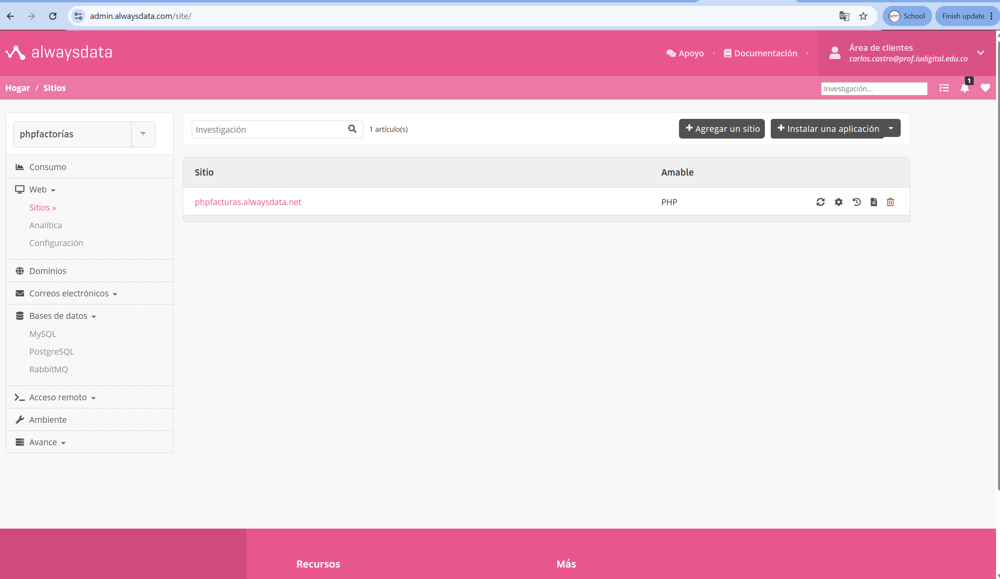

**Ábralo con el engranaje ⚙** y cambie **una sola casilla**:

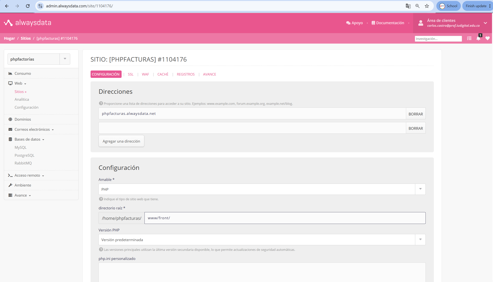

| La casilla | **Lo que se escribe** | Para qué |
|---|---|---|
| `directorio raíz` | **`www/front/`** | viene en `www/`. Como vamos a tener dos aplicaciones, cada una necesita su carpeta |

### 5.2 · El sitio de la API

**`+ Agregar un sitio`:**

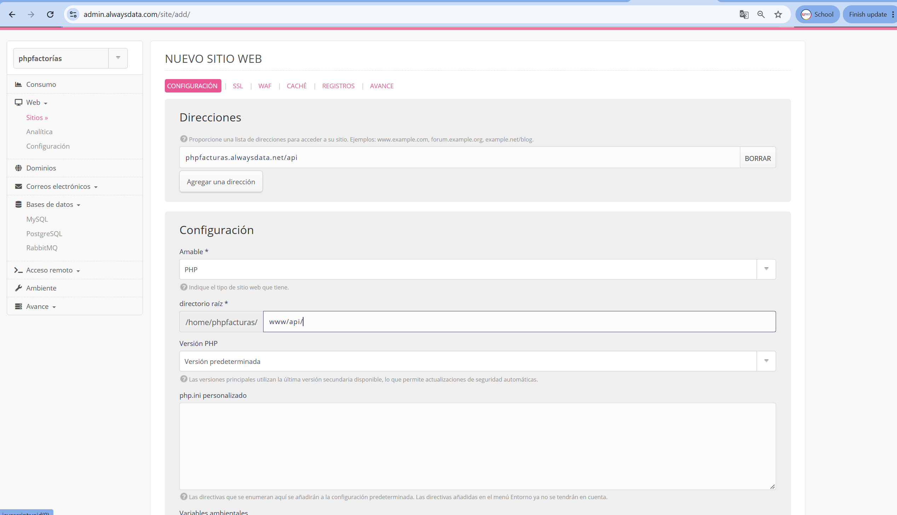

| La casilla | **Lo que se escribe** |
|---|---|
| `Direcciones` | **`phpfacturas.alwaysdata.net/api`** ← con `/api` al final |
| `Amable` (tipo) | `PHP` |
| `directorio raíz` | **`www/api/`** |

**Y antes de guardar**, en la misma página, **`Variables ambientales`**:

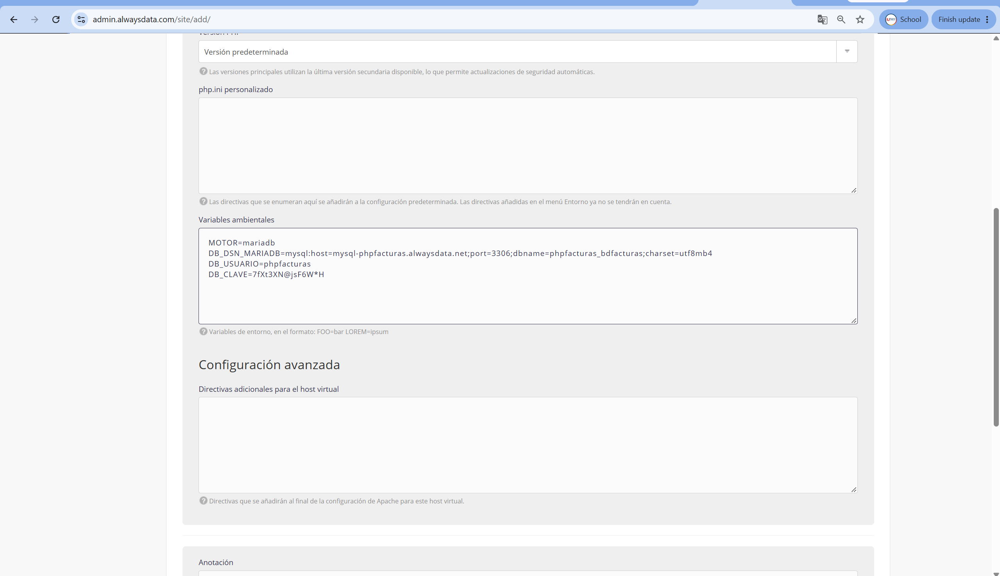

```
MOTOR=mariadb
DB_DSN_MARIADB=mysql:host=mysql-phpfacturas.alwaysdata.net;port=3306;dbname=phpfacturas_bdfacturas;charset=utf8mb4
DB_USUARIO=phpfacturas
DB_CLAVE=la-contraseña-de-su-cuenta
```

| La variable | Qué es |
|---|---|
| `MOTOR` | el interruptor de la v4: con cuál de los tres motores habla la API |
| `DB_DSN_MARIADB` | **dónde está la base de datos.** El host ya no es `mariadb` —el nombre del contenedor— sino el servidor de alwaysdata |
| `DB_USUARIO` · `DB_CLAVE` | las credenciales |

> **Y aquí está la diferencia que vale la clase:** esas credenciales quedaron
> **en el panel del hospedaje, no en un archivo del repositorio**. El código
> las lee con `getenv()`, igual que leía las del `docker-compose.yml`. **Por
> eso el repositorio puede ser público sin exponer nada.**

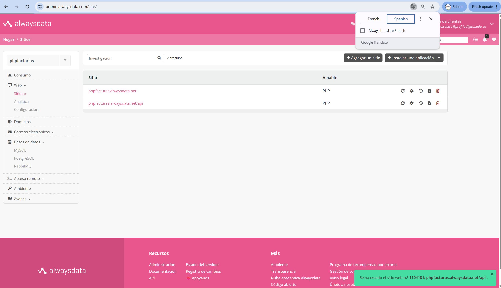

---

## Paso 6 — Subir el código: el servidor clona el repositorio

**En alwaysdata hay FTP, pero no lo vamos a usar.** Hay algo mejor: **SSH**, y
con SSH el servidor se baja el código **directamente de GitHub**.

> **Por qué es mejor que arrastrar archivos:** subir por FTP son miles de
> archivos y media hora, y al día siguiente nadie se acuerda de cuáles cambió.
> Con `git`, **actualizar es un comando**, y lo que está publicado es
> exactamente lo que está en el repositorio. Ni un archivo de más.

### 6.1 · Entrar

**`Acceso remoto` → `SSH/SFTP`:**

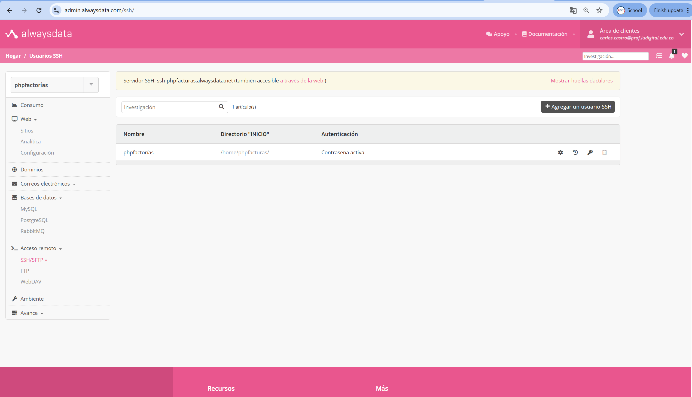

**Y no hace falta instalar nada:** el recuadro amarillo trae el enlace
**`a través de la web`**, que abre una terminal en el navegador.

Usuario **`phpfacturas`** y la contraseña de la cuenta. **No se ve mientras la
escribe** —ni puntos ni asteriscos—: es así a propósito.

### 6.2 · Clonar

```bash
git clone https://github.com/ccastro2050/proyecto_php4.git ~/repo
```

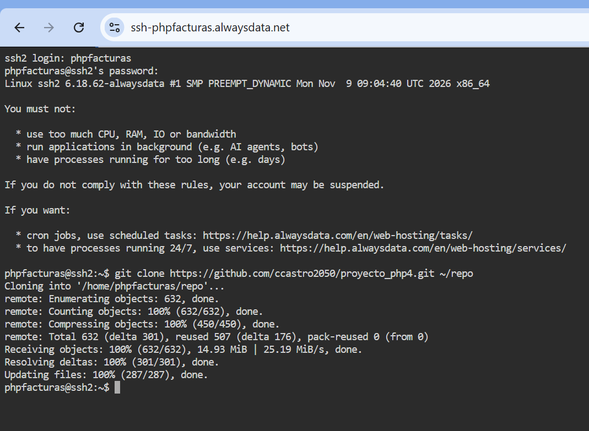

```
Cloning into '/home/phpfacturas/repo'...
Receiving objects: 100% (632/632), 14.93 MiB | 25.19 MiB/s, done.
Updating files: 100% (287/287), done.
```

> **El estudiante pone aquí la dirección de SU repositorio.** Y si es privado,
> tendrá que autenticarse; lo más simple para un curso es que sea público, que
> es lo que hacemos aquí — **justamente porque las contraseñas no están
> adentro.**

### 6.3 · Los dos atajos

**El código quedó en `~/repo`, pero los sitios buscan en `~/www/api` y
`~/www/front`.** Esas dos carpetas todavía no existen:

```bash
ln -s ~/repo/api_facturas ~/www/api
ln -s ~/repo/front_php ~/www/front
ls -l ~/www
```

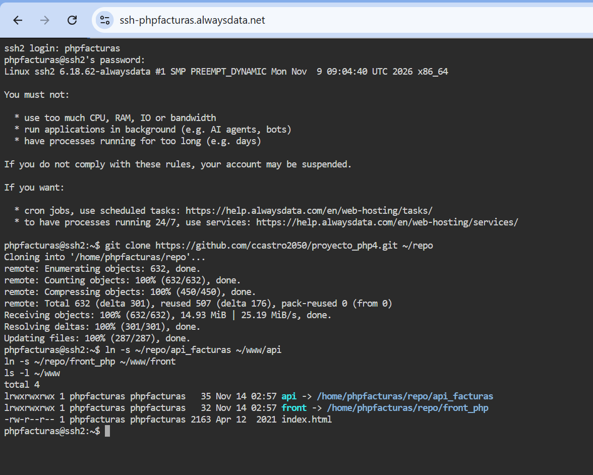

```
api   -> /home/phpfacturas/repo/api_facturas
front -> /home/phpfacturas/repo/front_php
```

| | |
|---|---|
| **`ln -s` crea un atajo**, como el acceso directo de Windows | **no copia nada**: apunta |
| Por eso el código vive **en un solo sitio** | y mañana, `cd ~/repo && git pull` actualiza **las dos aplicaciones de una vez** |

---

## Paso 7 — El `.htaccess`, y por qué sin él no funciona nada

**Con el código subido, la API respondía esto:**

```
404 Not Found — The requested URL was not found on this server.
```

**Y no era culpa de la API: nunca llegó a ejecutarse.** En el registro de
Apache (`~/admin/logs/apache/`) estaba escrito:

```
AH00128: File does not exist: /home/phpfacturas/www/api/sesion
```

### Qué está pasando

| En su máquina | En el hospedaje |
|---|---|
| `php -S 0.0.0.0:8090 index.php` | **Apache** |
| Ese último argumento convierte a `index.php` en **el router**: *todas* las peticiones entran por ahí | Apache lee la URL **como una ruta de archivos**: para `/api/sesion` busca una carpeta `api` con un archivo `sesion` adentro |

> **Es el tropiezo número uno al publicar una API de PHP**, y es
> desconcertante porque **el código está bien**. La aplicación no se equivocó:
> no la llamaron.

### La solución: cuatro renglones, uno por aplicación

**El repositorio ya los trae** (`api_facturas/.htaccess` y
`front_php/.htaccess`). Esto es lo que dicen:

```apache
RewriteEngine On

RewriteCond %{REQUEST_FILENAME} !-f
RewriteCond %{REQUEST_FILENAME} !-d
RewriteRule ^ index.php [L,QSA]
```

| El renglón | Qué hace |
|---|---|
| `RewriteEngine On` | enciende la reescritura de direcciones |
| `!-f` y `!-d` | **solo** reescribir si lo pedido **no** es un archivo ni una carpeta que existan. Así el CSS y las imágenes se sirven directo, sin pasar por PHP |
| `RewriteRule ^ index.php [L,QSA]` | todo lo demás, a `index.php`. `[L]` = última regla; `[QSA]` = conserva lo que venga después del `?` |

### Y el segundo tropiezo, que costó otro rato

**La primera versión de ese archivo llevaba los comentarios al final de la
línea**, y el sitio entero empezó a responder **500**:

```
/home/phpfacturas/www/api/.htaccess: RewriteCond: bad flag delimiters
```

> **Apache no admite comentarios en la misma línea de una directiva.** Esto
> está mal:
>
> ```apache
> RewriteCond %{REQUEST_FILENAME} !-f    # no es un archivo
> ```
>
> El servidor intenta leer ese texto como parte de la condición. **El
> comentario va en su propio renglón**, siempre.
>
> **Y la lección de fondo no es el `.htaccess`: es dónde se mira.** Las dos
> veces, la respuesta estaba escrita en `~/admin/logs/apache/` y en ningún
> otro lado:
>
> ```bash
> tail -n 15 ~/admin/logs/apache/*
> ```

### Traer el arreglo al servidor

```bash
cd ~/repo && git pull
```

**Y ahí sí, la API publicada contesta:**

```powershell
Invoke-RestMethod -Method Post -Uri https://phpfacturas.alwaysdata.net/api/sesion `
  -ContentType "application/json" `
  -Body '{"email":"admin@correo.com","contrasena":"admin123"}'
```

```
token   : eyJhbGciOiJIUzI1NiIsInR5cCI6IkpXVCJ9...
email   : admin@correo.com
roles   : {Administrador}
expira  : 2026-11-14T04:03:34+01:00
```

> **Ese token prueba el camino completo:** Apache recibió la petición, se la
> pasó a `index.php`, el enrutador llamó al controlador de sesión, el
> repositorio consultó la tabla `usuario` **en la MariaDB de alwaysdata**, y
> volvió. Si cualquiera de los pasos anteriores estuviera mal, aquí no habría
> token.

---

> **En construcción.** Falta el paso 8 —la variable `URL_API` del front y la
> prueba del sistema completo— que se escribe cuando se ejecute: este
> documento no describe nada que no se haya hecho de verdad.
